# hash-audit

hash-audit reads a shadow file or an Apache style htpasswd file and classifies every account's password hash: empty passwords, plaintext, unsalted SHA-1, DES and MD5 crypt, bcrypt with a low cost, SHA-crypt with few rounds, and several users sharing the same hash. It never prints a hash and never tries to crack one: it only looks at the format.



**Live demo:** https://jvch0512.github.io/hash-audit/ (Synthetic accounts with invented hash strings.)

D (LDC), Phobos only. The demo page is rendered from the tool's `--tsv` output by `scripts/site.py` (Python 3, only needed to regenerate the page).

## Use

```bash
make build
./bin/hash-audit examples/shadow.sample examples/htpasswd.sample
./bin/hash-audit /etc/shadow --tsv            # as root
./bin/hash-audit .htpasswd --fail-on high     # exit 1 in CI
```

Both formats are detected per line: a shadow entry has the colon separated fields of `/etc/shadow`, an htpasswd entry is `user:hash`.

| Rule | Severity | What it catches |
|---|---|---|
| HA001 | critical | empty password, or a `{PLAIN}` / unrecognised plaintext value that logs in as typed |
| HA002 | high | unsalted or reversible: `{SHA}` (plain SHA-1), `{SSHA}` (fast salted SHA-1) |
| HA003 | high | MD5 crypt (`$1$`), Apache `$apr1$`, traditional DES crypt (8 character limit) |
| HA004 | medium | bcrypt cost below 10, SHA-crypt (`$5$`, `$6$`) below 10000 rounds, including the default 5000 |
| HA005 | medium | several accounts share exactly the same hash, so they share a password |
| HA006 | info | count of strong hashes (yescrypt, scrypt, argon2, bcrypt cost 10 or more, SHA-crypt with enough rounds) and locked accounts |

Locked accounts (`!`, `*`, `!!`) are counted and otherwise ignored.

See [examples](examples) and [docs/sample-output.txt](docs/sample-output.txt).

## Limits

- Format only. A strong algorithm with a weak password (`Password1`) is not detected, that needs a cracking tool and authorisation.
- Reuse detection compares full hash strings. Salted hashes of the same password differ, so reuse is a lower bound.
- Hash text is never printed, only the account name, line number and algorithm.
- Reading `/etc/shadow` needs root. Use a copy you are allowed to audit.

## Where it fits

Server hardening and identity reviews: evidence of weak credential storage in legacy web apps, appliances and Linux fleets, with no secrets in the report.

## Tests

```bash
make test    # 59 checks
```

MIT.

## Code scanning (SARIF)

`scripts/tsv2sarif.py` converts the `--tsv` output into SARIF 2.1.0, so findings show up in GitHub code scanning:

```sh
./bin/hash-audit examples/shadow.sample examples/htpasswd.sample --tsv | python3 scripts/tsv2sarif.py --tool hash-audit --prefix examples > results.sarif
```

Upload `results.sarif` with `github/codeql-action/upload-sarif`. Severities map to SARIF levels (critical and high to error, medium to warning, low and info to note) and to a `security-severity` score.
